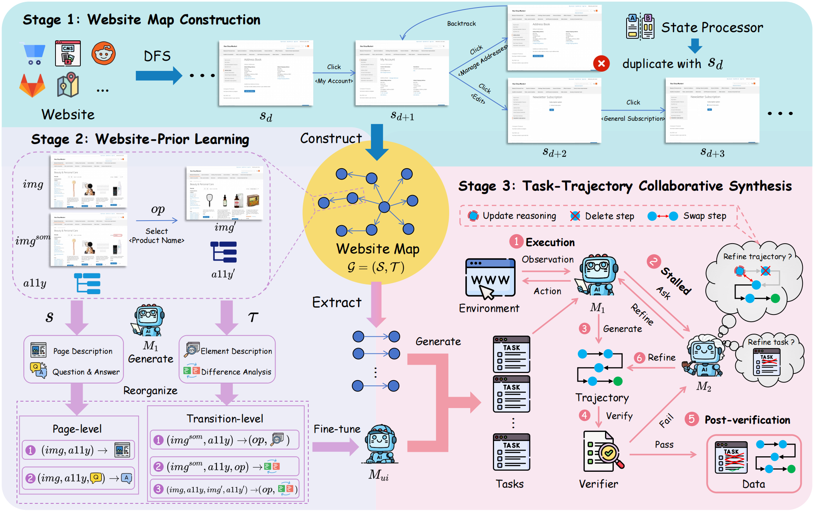

<div align="center">

# SynWeaver

### Website-Prior Task and Trajectory Co-Synthesis for Web Agents

**English** | [简体中文](README_ZH.md)

[](https://www.python.org/)
[](LICENSE)
[](https://webarena.dev/)

</div>

## 🔬 Overview

Training Web Agents requires high-quality task-trajectory supervision, but manually annotating interaction trajectories on real websites is expensive. Existing automated synthesis methods also face two recurring limitations: exploration is repetitive and struggles to cover a website's functional topology, while insufficient website-specific knowledge often produces tasks that are infeasible or inconsistent with the page's actual capabilities.

**SynWeaver** is a website-prior framework for task and trajectory co-synthesis. Instead of treating task generation and trajectory execution as independent processes, it first builds a website map through structured exploration, learns UI priors from page states and state transitions, and then jointly revises task intent and deviating trajectories during execution. Heuristic validation and optional reconstruction retain executable, semantically consistent training data.

This repository provides the data construction and validation implementation of the research method, including website map construction, UI supervision generation, high-level task synthesis, WebArena trajectory execution, and dataset validation and export.

<p align="center">
  
</p>

<p align="center"><em>Overview of the SynWeaver method</em></p>

### Core Ideas

1. **Structured website exploration:** use DFS to construct a website map whose nodes represent functionally distinct page states and whose edges represent executable interactions, reducing redundant visits from random exploration.
2. **Website-prior learning:** construct five types of UI supervision from page states and transitions so that a model can learn page structure, element functionality, and action outcomes.
3. **Task-trajectory co-synthesis:** derive high-level tasks from validated state transitions and jointly update tasks and trajectories when execution stalls or the task conflicts with page capabilities.
4. **Post-validation and repair:** filter candidates with termination validity, trajectory legality, and repeated-action checks, with optional reconstruction of failed trajectories by a stronger teacher model.

## 🧭 Method and Data Flow

SynWeaver implements a three-stage research workflow through five independently runnable engineering modules.

```mermaid
flowchart LR
    A[Target website] --> B["crawler · Structured exploration"]
    B --> C[(Neo4j website map)]
    C --> D["ui_dataset · Five UI supervision types"]
    C --> E["task_gen · Reversed task synthesis"]
    D --> F["UI-aware model · Training stage"]
    F -. Provides website priors .-> E
    E --> G["traj · Task-trajectory co-execution"]
    G --> H["validate · Validation and optional reconstruction"]
    H --> I[ShareGPT training data]
    classDef module fill:#eaf2ff,stroke:#2563eb,stroke-width:2px,color:#0f172a
    class B,D,E,G,H module
```



| Research stage | Entry point | Input | Main output |
|---|---|---|---|
| Website map construction | `python -m cli.crawl` | Target URL and website namespace | Neo4j state graph, screenshots, logs, and videos |
| Website-prior dataset construction | `python -m cli.ui_dataset` | Neo4j namespace | Five UI JSONL datasets and images |
| High-level task synthesis | `python -m cli.task_gen` | Neo4j state transitions | `task_<website>.jsonl` |
| Collaborative trajectory synthesis | `python -m cli.traj` | High-level task JSONL | Execution trajectories, screenshots, and evaluation results |
| Post-validation and export | `python -m cli.validate` | Complete trajectory run | `train_sharegpt.jsonl`, validation report, and images |

### UI Supervision Signals

The website-prior dataset contains two page-level tasks and three transition-level tasks:

- `page_description`: understand page content, structure, and visual style.
- `page_qa`: answer questions about information on the page.
- `element_description`: understand element functionality and interaction methods.
- `state_transition`: predict page changes after an action.
- `action_prediction`: infer the action and resulting changes from before and after states.

## 🗂️ Project Structure

```text
synweaver/
├── cli/                 # Command-line entry points for the five modules
├── config/              # Module and shared runtime configuration
├── crawler/             # Website exploration, state comparison, and Neo4j maps
├── examples/            # Public site-specific command examples
├── llm/                 # Unified OpenAI-compatible LLM client
├── prompts/             # Centralized prompts
├── scripts/             # Dataset merge and validation utilities
├── storage/             # Run, manifest, JSONL, and Neo4j storage
├── tasks/
│   ├── generation/      # High-level task synthesis
│   ├── execution/       # T1/T2 collaborative trajectory execution
│   └── validation/      # Heuristic validation, reconstruction, and ShareGPT export
├── ui_dataset/          # UI supervision data generation
├── assets/method.png    # Method overview figure
├── config.example.yaml  # Public LLM configuration example
├── pyproject.toml
├── README.md            # English documentation
└── README_ZH.md         # Chinese documentation
```

## ⚙️ Environment Setup

### Requirements

- Python 3.11+
- `uv`
- Neo4j
- Playwright Chromium
- A WebArena checkout, normally at `../webarena`
- Access to an OpenAI-compatible LLM service
- Optional: `ffmpeg`, only for merging crawler video segments

### Install Dependencies

Run from the project root:

```bash
cd "<SYNWEAVER_ROOT>"
uv sync
source .venv/bin/activate
uv pip install --no-deps -e "<WEBARENA_ROOT>"
playwright install chromium
```

If browser system dependencies are missing on Linux, run:

```bash
playwright install-deps chromium
```

If WebArena is not in the default sibling directory, set:

```bash
export WEBARENA_ROOT="<WEBARENA_ROOT>"
```

<details>
<summary><strong>❕WebArena integration changes and required source patch</strong></summary>

SynWeaver integrates an external WebArena checkout rather than vendoring it. The official WebArena requirements pin older `playwright==1.32.1` and `openai==0.27.0` releases, which conflict with SynWeaver's current runtime. Install WebArena without its dependencies as shown above; `uv sync` installs the compatible auxiliary dependencies declared by this project.

`tasks/execution/webarena_path.py` locates `WEBARENA_ROOT` explicitly or discovers the sibling `../webarena` checkout. It exposes both import layouts required by the two projects: `webarena.browser_env` for SynWeaver and top-level `browser_env` for WebArena scripts and auto-login subprocesses.

One source change is still required in the external checkout. Patch `browser_env/envs.py` so `ScriptBrowserEnv` always releases an active Sync Playwright dispatcher when initialization fails or the environment closes. Without this cleanup, a timeout from `page.goto()` or another setup step can leave the dispatcher running, causing subsequent tasks in the same process to fail with `Playwright Sync API inside the asyncio loop`.

Apply the following change to `<WEBARENA_ROOT>/browser_env/envs.py`:

```diff
@@
         super().reset(seed=seed, options=options)
         if self.reset_finished:
             self.context_manager.__exit__()
+            self.reset_finished = False

-        if options is not None and "config_file" in options:
-            config_file = Path(options["config_file"])
-            if config_file.exists():
-                self.setup(config_file=config_file)
+        try:
+            if options is not None and "config_file" in options:
+                config_file = Path(options["config_file"])
+                if config_file.exists():
+                    self.setup(config_file=config_file)
+                else:
+                    raise ValueError(f"Config file {config_file} does not exist.")
             else:
-                raise ValueError(f"Config file {config_file} does not exist.")
-        else:
-            self.setup()
-        self.reset_finished = True
-
-        if self.sleep_after_execution > 0:
-            time.sleep(self.sleep_after_execution)
-
-        observation = self._get_obs()
-        observation_metadata = self._get_obs_metadata()
-        info = {
-            "page": DetachedPage(self.page.url, ""),
-            "fail_error": "",
-            "observation_metadata": observation_metadata,
-        }
-        return (observation, info)
+                self.setup()
+            self.reset_finished = True
+
+            if self.sleep_after_execution > 0:
+                time.sleep(self.sleep_after_execution)
+
+            observation = self._get_obs()
+            observation_metadata = self._get_obs_metadata()
+            info = {
+                "page": DetachedPage(self.page.url, ""),
+                "fail_error": "",
+                "observation_metadata": observation_metadata,
+            }
+            return (observation, info)
+        except Exception:
+            if hasattr(self, "context_manager") and getattr(
+                self.context_manager, "_connection", None
+            ) is not None:
+                self.context_manager.__exit__()
+            self.reset_finished = False
+            raise
@@
     def close(self) -> None:
-        if self.reset_finished:
+        if hasattr(self, "context_manager") and getattr(
+            self.context_manager, "_connection", None
+        ) is not None:
             self.context_manager.__exit__()
+        self.reset_finished = False
```

This external modification is not tracked by the SynWeaver repository. Reapply or verify it after cloning, replacing, or updating WebArena:

```bash
python -m py_compile "<WEBARENA_ROOT>/browser_env/envs.py"
git -C "<WEBARENA_ROOT>" diff -- browser_env/envs.py
```

</details>

### Configure Neo4j

```bash
export NEO4J_URL="<NEO4J_URL>"
export NEO4J_USERNAME="<NEO4J_USERNAME>"
export NEO4J_PASSWORD="<NEO4J_PASSWORD>"
```

### Configure LLMs

Copy the configuration template:

```bash
cp config.example.yaml config.yaml
```

Configure the five logical roles in `config.yaml`:

| Configuration key | Role | Purpose |
|---|---|---|
| `CRAWLER_TEXT_MODEL` | `crawler_text` | Page candidate filtering and form value generation |
| `CRAWLER_VISION_MODEL` | `crawler_vision` | Visual comparison of backtracked states |
| `T1_MODEL` | `t1` | UI dataset construction and trajectory execution |
| `T2_MODEL` | `t2` | Collaborative optimization and failed-trajectory reconstruction |
| `TASK_GEN_MODEL` | `task_gen` | High-level task generation |

Provide the environment variables referenced by the template, for example:

```bash
export OPENROUTER_API_KEY="<OPENROUTER_API_KEY>"
```

The exact `base_url`, `model_id`, and optional compatibility parameters depend on the selected gateway. `config.yaml` should contain only `$ENV_VAR` references for credentials. Never write real secrets to configuration files, logs, manifests, or Git history.

## 🚀 Quick Start

Run the following examples from the project root. Start with a small `--max-samples` value to verify the environment before scaling up data generation.

### Step 0: Prepare Authentication State (Optional)

For websites that require authentication, first generate a Playwright storage state:

```bash
export LOGIN_USERNAME="<username>"
export LOGIN_PASSWORD="<password>"

python -m cli.login \
  --site shopping \
  --url "<SHOPPING_LOGIN_URL>"
```

The storage state is written to `.auth/` or to the path specified by `--storage-state`.

### Step 1: Construct the Website Map

```bash
python -m cli.crawl \
  --site shopping \
  --url "<SHOPPING_URL>" \
  --storage-state-path "<SHOPPING_STORAGE_STATE_PATH>" \
  --headless
```

See [WebArena crawler commands](examples/crawler_commands.md) for complete commands for five sites. The crawler explores the target website with DFS and writes functionally distinct states and executable transitions to Neo4j. The namespace is automatically appended to the run ID, for example `20260809_120000_shopping`; recordings are stored in the current run's `videos/` directory by default.

> **Warning:** Do not move, rename, or change the standard crawler run directory `outputs/crawler/<run_id>/` or any of its artifact subdirectories. The website map records paths to upstream files such as screenshots and accessibility trees. UI dataset synthesis and task synthesis use those paths to locate the files; changing the directory location or naming will break downstream artifact lookup.

### Step 2: Build the Website-Prior UI Dataset

```bash
python -m cli.ui_dataset \
  --namespace shopping \
  --max-samples 100 \
  --workers 8
```

After generating runs for multiple websites, merge them into a unified UI training dataset:

```bash
python -m scripts.merge_ui_datasets \
  --input-dir outputs/ui_dataset/<shopping-run-id> \
  --input-dir outputs/ui_dataset/<forum-run-id> \
  --seed 42 \
  --note multi-site
```

The merged dataset is written to `outputs/ui_dataset_merge/<run_id>/all_ui_data.jsonl`.

Then you can use this merged dataset to train a UI-aware model.

### Step 3: Generate High-Level Tasks

```bash
python -m cli.task_gen \
  --namespace shopping \
  --max-samples 100 \
  --tasks-per-transition 1 \
  --workers 1
```

Each generated task receives its `start_url` from the sampled transition's Neo4j source node (`GraphTriplet.from_url`). The task generator does not accept or invent a default start URL; transitions without a source-node URL are rejected before any LLM call. Use `--website-name` and `--target-sites` only when the display name or target sites differ from the namespace.

The primary output is:

```text
outputs/task_gen/<run_id>/task_shopping.jsonl
```

### Step 4: Execute Tasks and Synthesize Trajectories

```bash
python -m cli.traj \
  --tasks outputs/task_gen/<run_id>/task_shopping.jsonl \
  --workers 1 \
  --max-steps 25 \
  --url-override "SHOPPING=<SHOPPING_URL>"
```

> **Required mapping:** trajectory synthesis must include `--url-override "PLACEHOLDER=<SITE_URL>"` to map each logical site identifier in the task JSONL to the actual URL in the current environment. The mapping name must match the task identifier, for example `SHOPPING` for `__SHOPPING__`. Repeat the option for tasks involving multiple sites.

Use `--workers <count>` to control multiprocessing. Use `--no-headless` to show the browser, or `--no-refine` to disable T2 collaborative refinement.

### Step 5: Validate and Export ShareGPT Data

```bash
python -m cli.validate \
  --input-dir outputs/task_execution/<run_id> \
  --mode validate \
  --workers 1
```

The validation mode controls the finalization behavior:

- `validate`: run heuristic validation and export `train_sharegpt.jsonl` and `validation_report.json`.
- `reconstruct`: run validation and use T2 to reconstruct failed trajectories before export.
- `export`: skip heuristic validation and export the available trajectory data.

To enable T2 reconstruction explicitly, use:

```bash
python -m cli.validate \
  --input-dir outputs/task_execution/<run_id> \
  --mode reconstruct
```

After validating runs for multiple websites, merge the final trajectory datasets:

```bash
python -m scripts.merge_traj_datasets \
  --input-dir outputs/traj_datasets/<shopping-run-id> \
  --input-dir outputs/traj_datasets/<forum-run-id> \
  --note multi-site
```

The merged dataset is written to:

```text
outputs/traj_dataset_merge/<run_id>/train_sharegpt.jsonl
```

Validate image references in the merged dataset:

```bash
python -m scripts.validate_images \
  outputs/traj_dataset_merge/<run_id>/train_sharegpt.jsonl
```

## 🧰 Utilities

To merge crawler video segments, install `ffmpeg` and run:

```bash
python -m crawler.utils.merge_videos \
  outputs/crawler/<run_id>/videos \
  --output outputs/crawler/<run_id>/videos/merged_video.webm
```

## 🗺️ TODO

- [x] Release the code
- [x] Simplify command configuration
- [ ] Release the dataset
- [ ] Add parallel website map construction

## 🤝 Contributing

Contributions related to website exploration, UI supervision construction, task executability, trajectory validation, and cross-website generalization are welcome through issues and pull requests.

## 🔐 Safety and Responsible Use

SynWeaver automatically browses websites, triggers interactions, and may submit forms. Run it only against environments you are authorized to access, and comply with applicable terms of service, privacy policies, and laws.

Authentication state, input paths, URLs, screenshots, and manifests may contain sensitive or internal information. Review datasets and logs before publication. Provide real API keys and passwords only through environment variables or a secure secret management service.

## 📄 License

This project is available under the [MIT License](LICENSE). You may use, modify, and distribute it under the terms of that license.
