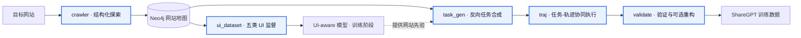

<div align="center">

# SynWeaver

### Website-Prior Task and Trajectory Co-Synthesis for Web Agents

面向 Web Agent 的网站先验任务-轨迹协同合成框架

[English](README.md) | **简体中文**

[](https://www.python.org/)
[](LICENSE)
[](https://webarena.dev/)

</div>

## 🔬 项目简介

Web Agent 的训练依赖高质量任务-轨迹监督，但人工标注真实网站上的交互轨迹成本高昂，已有自动合成方法又常受两个问题限制：一是探索过程重复且难以覆盖网站的功能拓扑，二是缺少网站特定知识时容易提出不可执行或与页面能力不一致的任务。

**SynWeaver** 是一个以网站先验为中心的任务与轨迹协同合成框架。它不把任务生成和轨迹执行视为彼此独立的过程，而是先通过结构化探索构建网站地图，再从页面状态和状态转移中学习 UI 先验，最后在执行过程中联合修正任务意图与偏离的轨迹，并通过启发式验证和重构筛选出可执行、语义一致的训练数据。

本仓库提供论文方法的数据构建与验证实现，覆盖网站地图构建、UI 监督数据生成、高层任务合成、WebArena 轨迹执行以及数据校验导出。

<p align="center">
  
</p>

<p align="center"><em>SynWeaver 方法总览</em></p>

### 核心研究思路

1. **结构化网站探索**：使用 DFS 构建网站地图，以功能上不同的页面状态为节点、可执行交互为边，减少随机游走中的冗余访问。
2. **网站先验学习**：从地图中的页面与转移构造五类 UI 监督信号，使模型学习页面结构、元素功能和动作结果。
3. **任务-轨迹协同合成**：从已验证的状态转移反向提出高层任务，在执行停滞或任务与页面不一致时联合更新任务和轨迹。
4. **后验证与修复**：通过终止有效性、轨迹合法性和重复动作检查过滤候选数据，并可调用更强教师模型重构失败轨迹。

## 🧭 方法与数据流

SynWeaver 包含三层研究流程，并映射为五个可独立运行的工程模块。



| 研究阶段 | 工程入口 | 输入 | 主要输出 |
|---|---|---|---|
| 网站地图构建 | `python -m cli.crawl` | 目标 URL、网站 namespace | Neo4j 状态图、截图、日志与视频 |
| 网站先验数据构建 | `python -m cli.ui_dataset` | Neo4j namespace | 五类 UI JSONL 与图片 |
| 高层任务合成 | `python -m cli.task_gen` | Neo4j 状态转移 | `task_<website>.jsonl` |
| 协同轨迹合成 | `python -m cli.traj` | 高层任务 JSONL | 执行轨迹、截图与评测结果 |
| 后验证与导出 | `python -m cli.validate` | 完整轨迹 run | `train_sharegpt.jsonl`、验证报告与图片 |

### UI 监督信号

网站先验数据由两类页面级任务和三类转移级任务组成：

- `page_description`：理解页面内容、结构和视觉样式。
- `page_qa`：针对页面信息进行问答。
- `element_description`：理解元素功能和交互方式。
- `state_transition`：预测动作执行后的页面变化。
- `action_prediction`：根据前后状态反推动作及变化。

## 🗂️ 项目结构

```text
synweaver/
├── cli/                 # 五个功能模块的命令行入口
├── config/              # 模块运行配置与共享配置
├── crawler/             # 网站探索、状态比较与 Neo4j 地图
├── examples/            # 可公开复用的站点启动命令
├── llm/                 # 统一 OpenAI-compatible LLM 客户端
├── prompts/             # 集中提示词
├── scripts/             # 数据集合并与检查工具
├── storage/             # run、manifest、JSONL 与 Neo4j 存储
├── tasks/
│   ├── generation/      # 高层任务合成
│   ├── execution/       # T1/T2 协同轨迹执行
│   └── validation/      # 启发式验证、重构与 ShareGPT 导出
├── ui_dataset/          # UI 监督数据生成
├── assets/method.png    # 论文方法图
├── config.example.yaml  # 可公开的 LLM 配置示例
├── pyproject.toml
├── README.md            # 英文文档
└── README_ZH.md         # 中文文档
```

## ⚙️ 环境准备

### 系统要求

- Python 3.11+
- `uv`
- Neo4j
- Playwright Chromium
- 与本项目同级的 WebArena：`../webarena`
- 可访问的 OpenAI-compatible LLM 服务
- 可选：`ffmpeg`，仅用于合并 crawler 录屏片段

### 安装依赖

在项目根目录执行：

```bash
cd "<SYNWEAVER_ROOT>"
uv sync
source .venv/bin/activate
uv pip install --no-deps -e "<WEBARENA_ROOT>"
playwright install chromium
```

Linux 缺少浏览器系统依赖时执行：

```bash
playwright install-deps chromium
```

WebArena 不在同级目录时设置：

```bash
export WEBARENA_ROOT="<WEBARENA_ROOT>"
```

<details>
<summary><strong>❕WebArena 集成改造与必需源码补丁</strong></summary>

SynWeaver 通过外部 checkout 集成 WebArena，不在本仓库内复制其源码。官方 WebArena requirements 固定了较旧的 `playwright==1.32.1` 和 `openai==0.27.0`，会与 SynWeaver 当前运行环境冲突，因此应按上文使用 `--no-deps` 安装 WebArena；`uv sync` 会安装本项目声明的兼容辅助依赖。

`tasks/execution/webarena_path.py` 优先读取显式 `WEBARENA_ROOT`，否则自动发现同级的 `../webarena`。该适配同时支持两个项目需要的导入形式：SynWeaver 使用 `webarena.browser_env`，WebArena 脚本和自动登录子进程使用顶层 `browser_env`。

外部 checkout 仍需修改一处源码。请补丁 `browser_env/envs.py`，确保 `ScriptBrowserEnv` 在初始化失败或环境关闭时始终释放活动的 Sync Playwright dispatcher。若 `page.goto()` 超时或其他 setup 步骤抛出异常后未清理 dispatcher，同一进程中的后续任务会持续出现 `Playwright Sync API inside the asyncio loop` 错误。

将以下改动应用到 `<WEBARENA_ROOT>/browser_env/envs.py`：

```diff
@@
         super().reset(seed=seed, options=options)
         if self.reset_finished:
             self.context_manager.__exit__()
+            self.reset_finished = False

-        if options is not None and "config_file" in options:
-            config_file = Path(options["config_file"])
-            if config_file.exists():
-                self.setup(config_file=config_file)
+        try:
+            if options is not None and "config_file" in options:
+                config_file = Path(options["config_file"])
+                if config_file.exists():
+                    self.setup(config_file=config_file)
+                else:
+                    raise ValueError(f"Config file {config_file} does not exist.")
             else:
-                raise ValueError(f"Config file {config_file} does not exist.")
-        else:
-            self.setup()
-        self.reset_finished = True
-
-        if self.sleep_after_execution > 0:
-            time.sleep(self.sleep_after_execution)
-
-        observation = self._get_obs()
-        observation_metadata = self._get_obs_metadata()
-        info = {
-            "page": DetachedPage(self.page.url, ""),
-            "fail_error": "",
-            "observation_metadata": observation_metadata,
-        }
-        return (observation, info)
+                self.setup()
+            self.reset_finished = True
+
+            if self.sleep_after_execution > 0:
+                time.sleep(self.sleep_after_execution)
+
+            observation = self._get_obs()
+            observation_metadata = self._get_obs_metadata()
+            info = {
+                "page": DetachedPage(self.page.url, ""),
+                "fail_error": "",
+                "observation_metadata": observation_metadata,
+            }
+            return (observation, info)
+        except Exception:
+            if hasattr(self, "context_manager") and getattr(
+                self.context_manager, "_connection", None
+            ) is not None:
+                self.context_manager.__exit__()
+            self.reset_finished = False
+            raise
@@
     def close(self) -> None:
-        if self.reset_finished:
+        if hasattr(self, "context_manager") and getattr(
+            self.context_manager, "_connection", None
+        ) is not None:
             self.context_manager.__exit__()
+        self.reset_finished = False
```

该修改位于外部 WebArena checkout，不受 SynWeaver 仓库版本控制。重新克隆、替换或更新 WebArena 后，需要重新应用或确认补丁：

```bash
python -m py_compile "<WEBARENA_ROOT>/browser_env/envs.py"
git -C "<WEBARENA_ROOT>" diff -- browser_env/envs.py
```

</details>

### 配置 Neo4j

```bash
export NEO4J_URL="<NEO4J_URL>"
export NEO4J_USERNAME="<NEO4J_USERNAME>"
export NEO4J_PASSWORD="<NEO4J_PASSWORD>"
```

### 配置 LLM

复制配置模板：

```bash
cp config.example.yaml config.yaml
```

配置 `config.yaml` 中的五个逻辑角色：

| 配置键 | 角色 | 用途 |
|---|---|---|
| `CRAWLER_TEXT_MODEL` | `crawler_text` | 页面候选过滤与表单值生成 |
| `CRAWLER_VISION_MODEL` | `crawler_vision` | 回溯状态的视觉比较 |
| `T1_MODEL` | `t1` | UI 数据构建与轨迹执行 |
| `T2_MODEL` | `t2` | 协同优化与失败轨迹重构 |
| `TASK_GEN_MODEL` | `task_gen` | 高层任务生成 |

在 shell 中提供模板引用的环境变量，例如：

```bash
export OPENROUTER_API_KEY="<OPENROUTER_API_KEY>"
```

具体 `base_url`、`model_id` 和可选兼容参数由所用网关决定。`config.yaml` 只应保存 `$ENV_VAR` 形式的环境变量引用；不要将真实密钥写入配置文件、日志、manifest 或 Git 历史。

## 🚀 快速开始

以下示例在项目根目录执行。请先用较小的 `--max-samples` 验证环境，再扩大数据规模。

### 第 0 步：准备登录态（可选）

需要认证的网站可先生成 Playwright 登录态：

```bash
export LOGIN_USERNAME="<username>"
export LOGIN_PASSWORD="<password>"

python -m cli.login \
  --site shopping \
  --url "<SHOPPING_LOGIN_URL>"
```

登录态写入 `.auth/` 或 `--storage-state` 指定路径。

### 第 1 步：构建网站地图

```bash
python -m cli.crawl \
  --site shopping \
  --url "<SHOPPING_URL>" \
  --storage-state-path "<SHOPPING_STORAGE_STATE_PATH>" \
  --headless
```

WebArena 五个站点的完整启动命令见 [站点爬取命令](examples/crawler_commands.md)。crawler 使用 DFS 探索目标网站，将功能上不同的状态和可执行转移写入 Neo4j。run ID 自动追加 namespace，例如 `20260809_120000_shopping`；录屏默认写入当前 run 的 `videos/`。

> **警告：** 不要移动、重命名或改变 crawler 标准输出目录 `outputs/crawler/<run_id>/` 及其 artifact 子目录。网站地图会记录截图、可访问性树等上游文件路径，UI 数据合成和任务合成会依据这些记录读取文件；修改目录位置或命名会导致下游无法找到对应产物。

### 第 2 步：构建网站先验 UI 数据

```bash
python -m cli.ui_dataset \
  --namespace shopping \
  --max-samples 100 \
  --workers 1
```

针对多个网站分别生成后，可合并为统一 UI 训练集：

```bash
python -m scripts.merge_ui_datasets \
  --input-dir outputs/ui_dataset/<shopping-run-id> \
  --input-dir outputs/ui_dataset/<forum-run-id> \
  --seed 42 \
  --note multi-site
```

合并结果位于 `outputs/ui_dataset_merge/<run_id>/all_ui_data.jsonl`。随后可使用该合并数据集训练具备 UI 感知能力的模型。

### 第 3 步：生成高层任务

```bash
python -m cli.task_gen \
  --namespace shopping \
  --max-samples 100 \
  --tasks-per-transition 1 \
  --workers 1
```

每条生成任务的 `start_url` 都来自采样 transition 的 Neo4j 源节点（`GraphTriplet.from_url`）。task gen 不接受或臆造默认 start URL；源节点 URL 缺失的 transition 会在调用 LLM 前被拒绝。只有展示名称或目标站点不同于 namespace 时，才需要显式提供 `--website-name` 或 `--target-sites`。

主要产物为：

```text
outputs/task_gen/<run_id>/task_shopping.jsonl
```

### 第 4 步：执行任务并合成轨迹

```bash
python -m cli.traj \
  --tasks outputs/task_gen/<run_id>/task_shopping.jsonl \
  --workers 1 \
  --max-steps 30 \
  --url-override "SHOPPING=<SHOPPING_URL>"
```

> **必填映射：** 轨迹合成必须提供 `--url-override "PLACEHOLDER=<SITE_URL>"`，将任务 JSONL 中的逻辑站点标识映射到当前环境的实际 URL。映射名需与任务标识一致，例如 `__SHOPPING__` 对应 `SHOPPING`；多站点任务可重复传入该参数。

通过 `--workers <count>` 控制多进程数量。需要显示浏览器时使用 `--no-headless`；禁用 T2 协作优化时使用 `--no-refine`。

### 第 5 步：验证并导出 ShareGPT 数据

```bash
python -m cli.validate \
  --input-dir outputs/task_execution/<run_id> \
  --mode validate \
  --workers 1
```

验证模式决定最终处理方式：

- `validate`：执行启发式校验，并导出 `train_sharegpt.jsonl` 和 `validation_report.json`。
- `reconstruct`：执行校验，并在导出前使用 T2 重构失败轨迹。
- `export`：跳过启发式校验，直接导出现有轨迹数据。

需要显式启用 T2 重构时使用：

```bash
python -m cli.validate \
  --input-dir outputs/task_execution/<run_id> \
  --mode reconstruct
```

针对多个网站分别完成验证后，合并最终轨迹数据集：

```bash
python -m scripts.merge_traj_datasets \
  --input-dir outputs/traj_datasets/<shopping-run-id> \
  --input-dir outputs/traj_datasets/<forum-run-id> \
  --note multi-site
```

合并结果位于：

```text
outputs/traj_dataset_merge/<run_id>/train_sharegpt.jsonl
```

检查合并数据的图片引用：

```bash
python -m scripts.validate_images \
  outputs/traj_dataset_merge/<run_id>/train_sharegpt.jsonl
```

## 🧰 辅助工具

合并 crawler 录屏片段，需要系统已安装 `ffmpeg`：

```bash
python -m crawler.utils.merge_videos \
  outputs/crawler/<run_id>/videos \
  --output outputs/crawler/<run_id>/videos/merged_video.webm
```

## 🗺️ TODO

- [x] 发布代码
- [x] 简化启动脚本的参数配置
- [ ] 开源数据集
- [ ] 为网站地图构建增加并行机制

## 🤝 参与贡献

欢迎围绕网站探索、UI 监督构造、任务可执行性、轨迹验证和跨网站泛化提交 issue 或 pull request。

## 🔐 安全与责任使用

SynWeaver 会自动浏览网站、触发交互并可能提交表单。请仅在拥有授权的目标环境中运行，并遵守网站服务条款、隐私政策和适用法律。

登录态、输入路径、URL、截图和 manifest 可能包含敏感或内部信息。发布数据或日志前应进行人工检查；真实密钥和密码只应通过环境变量或安全密钥管理服务提供。

## 📄 开源许可

本项目采用 [MIT License](LICENSE)。你可以在许可证条款允许的范围内使用、修改和分发本项目代码。
